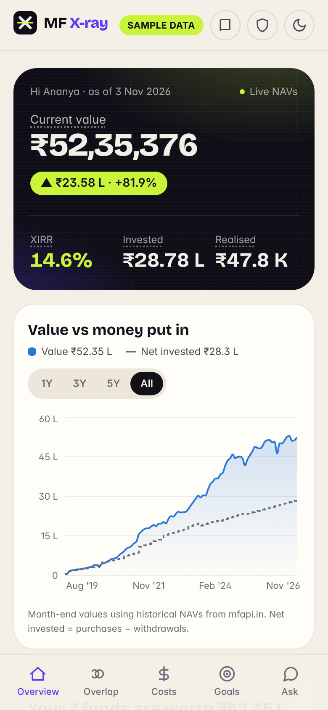
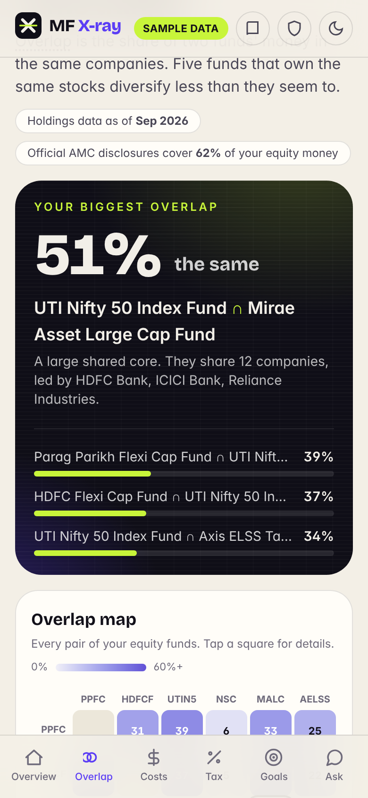
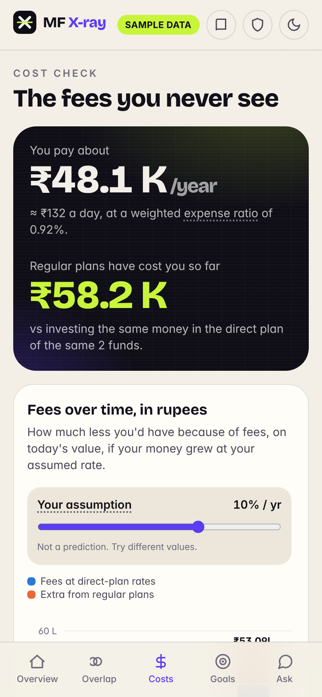
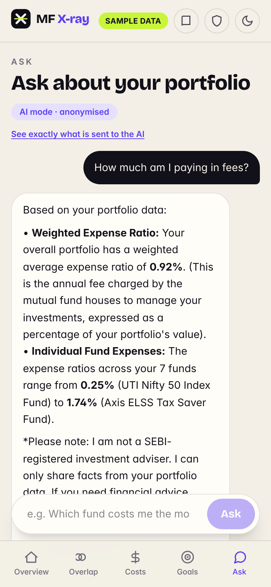
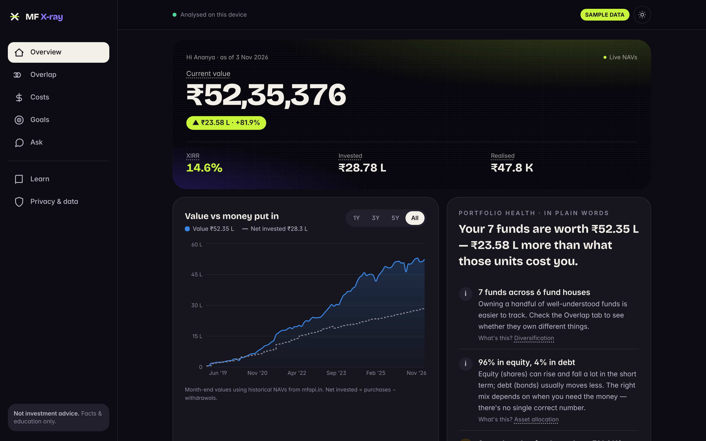
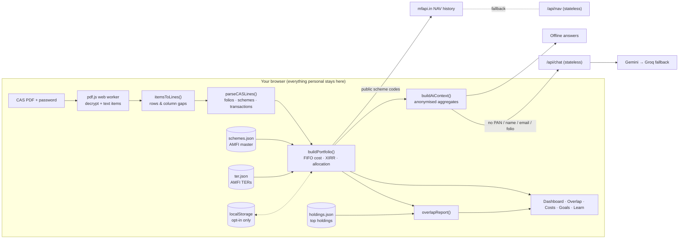

<div align="center">


# MF X-ray

**See inside your mutual funds.** Drop in your CAMS/KFintech statement and get your true XIRR, hidden fees,
overlapping funds and goal progress — explained in plain language, computed entirely in your browser.

`Next.js 16` · `TypeScript` · `Installable PWA` · `Mobile-first` · `Zero uploads`

</div>

<p align="center">
  
  
  
  
</p>

<p align="center"></p>

> Screenshots are real captures of the app running the built-in **synthetic** sample portfolio (a fictional investor).

## Why

Indian investors get a Consolidated Account Statement (CAS) listing every mutual fund transaction — but it's a
40-page PDF of numbers. MF X-ray turns it into answers: *How fast has my money actually grown? Am I paying
commission without knowing? Do my five funds secretly own the same ten companies?*

**Privacy is the architecture, not a policy.** The password-protected PDF is decrypted and parsed by pdf.js in a
web worker on your device. There's no upload, account or database. Only public scheme codes are used to fetch NAVs,
and optional AI chat receives only anonymous totals — never PAN, name, email or folio numbers.

## Features

| | |
|---|---|
| **Portfolio dashboard** | Current value (marked to the latest NAV), FIFO cost, unrealised & realised gains, **true XIRR** overall and per fund, value-vs-invested chart, allocation by asset class / category / fund house, and a past-only reference: the same cash flows replayed on a Nifty 50 index fund |
| **Fund overlap** | Pairwise overlap heat-map, common stocks per pair, look-through exposure (“you own ₹4.2 L of HDFC Bank across 6 funds”) |
| **Cost check** | Real regular & direct TERs from AMFI, fee drag in rupees over 5/10/20 years at *your* assumption, regular-plan detection, and money already lost — computed by replaying your purchases on the direct plan's actual NAV history |
| **Goal tracker** | Earmark funds (or a share of them) for goals; progress rings; monthly amount needed under a growth rate you choose |
| **Beginner layer** | Every term is tappable for a plain-language explainer; a “portfolio health” summary of facts; 2-minute learn cards; searchable glossary |
| **Ask your portfolio** | Chat answered from your parsed data via Gemini or Groq (with fallback), or fully offline. “See exactly what is sent” shows the anonymised JSON |
| **Private by default** | In-memory only unless you turn on “Remember on this device”; one-tap **Delete my data** |
| **Installable PWA** | Manifest, icons, offline app shell, cached NAVs; light & dark themes |
| **Try with sample data** | A realistic synthetic CAS (fake person, fake folios, real schemes and NAVs) — no real data needed |

**Compliance:** MF X-ray is an educational tool, not SEBI-registered investment advice. It states facts and explains
concepts; it never recommends buying/selling/switching and never forecasts returns. Any projection uses a growth rate
the user picks, labelled as an assumption.

## Tech stack

- **Next.js 16** (App Router, Turbopack) · **React 19** · **TypeScript** (strict)
- **Tailwind CSS 4** with design tokens for light/dark · Bricolage Grotesque + Instrument Sans
- **pdf.js 5** for in-browser decryption & text extraction · custom CAS parser
- **Recharts 3** with a CVD-validated categorical palette
- **zustand** for state · hand-written service worker
- **Vitest** — 39 tests covering CAS parsing (on the real sample PDF), XIRR, overlap, costs, goals, anonymisation
- Data: **mfapi.in** (NAV history), **AMFI** NAVAll (scheme master) and TER disclosures (expense ratios)
- LLMs behind a tiny provider interface: **Gemini** (`GEMINI_API_KEY`) or **Groq** (`GROQ_API_KEY`), offline fallback

## Architecture



## Getting started

```bash
git clone https://github.com/sarthakjain29/mf-x-ray.git
cd mf-x-ray
npm install
npm run dev
```

Open http://localhost:3000 and click **Try with sample data** (sample PDF password: `mfxray`), or upload your own
CAS: request a **Detailed** statement from [CAMS](https://www.camsonline.com)
or [KFintech](https://www.kfintech.com), period from your first investment.

Optional AI chat: `cp .env.example .env.local` and add a free `GEMINI_API_KEY` and/or `GROQ_API_KEY`.

```bash
npm run check   # typecheck + lint + tests
npm run build   # production build
```

Deploying (Vercel free tier), regenerating the sample/data snapshots, decisions and known issues are in
**[developer.md](developer.md)**.

## Roadmap

- [ ] Automated monthly ingestion of AMC portfolio disclosures (replace the approximate holdings snapshot)
- [ ] NSDL / CDSL depository CAS support
- [ ] Capital-gains view (STCG/LTCG, grandfathering) — facts only
- [ ] Scheduled refresh of AMFI scheme & TER snapshots via GitHub Actions
- [ ] Hindi and other Indian-language explainers

## Disclaimer

Educational tool, not investment advice. MF X-ray is not a SEBI-registered investment adviser. Past performance is not
indicative of future returns. Data may be incomplete or out of date — verify with your CAS and fund house.
